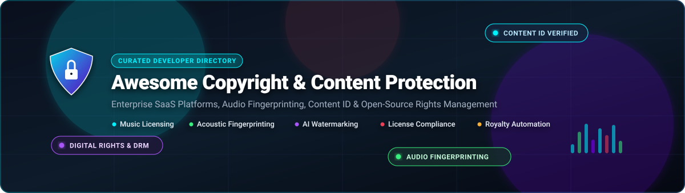
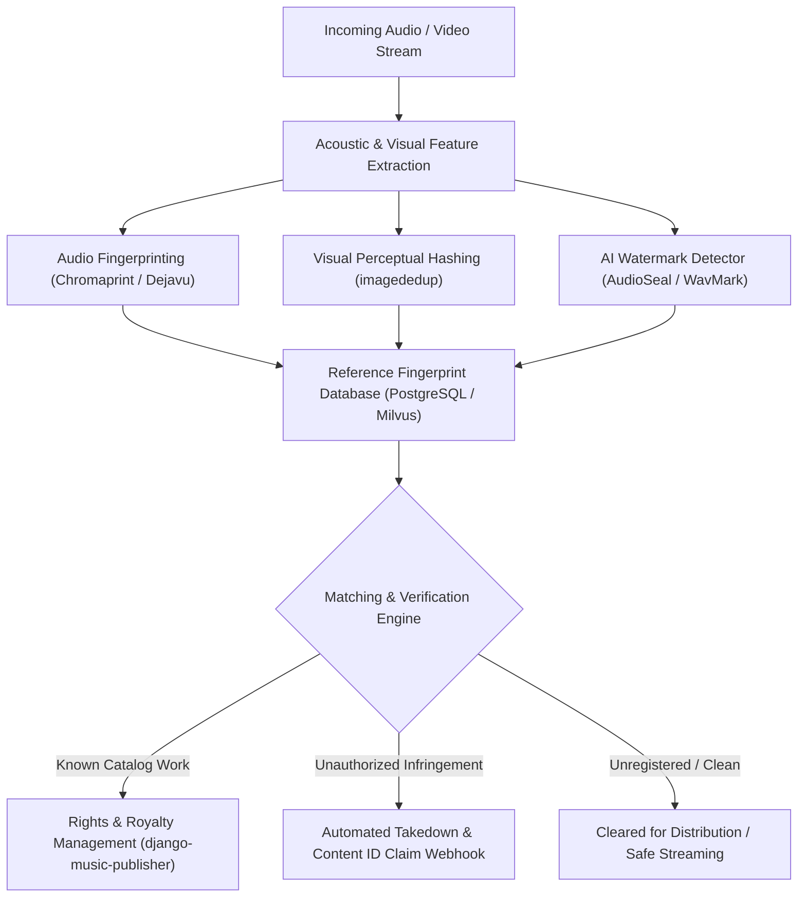

  
  
  
  
  
  
  
  

# 🛡️ Awesome Copyright &amp; Content Protection

**Curated Directory of Enterprise SaaS Solutions, Audio Fingerprinting Engines, Content ID Integrations &amp; Open-Source Rights Management Systems.**

---

### 📖 Overview &amp; SEO Keywords

> **Keywords:** *Copyright Protection, Content ID, Digital Rights Management (DRM), Audio Fingerprinting, Music Licensing, Royalty Management, Acoustic Fingerprint, Software License Compliance, Watermarking, Anti-Piracy, Intellectual Property Protection.*

In modern digital distribution, protecting intellectual property requires automated detection, transparent licensing, and robust forensic attribution. This repository curates leading commercial **SaaS platforms** and high-performance **open-source tools** spanning music licensing, acoustic fingerprinting, Content ID dispute clearing, software composition analysis (SCA), and digital watermarking.

---

## 📑 Table of Contents

- [🌐 Sector Overview &amp; Market Dynamics](#-sector-overview--market-dynamics)
- [💼 SaaS &amp; Hosted Platforms](#-saas--hosted-platforms)
- [💻 Open-Source GitHub Projects (Ranked by Stars)](#-open-source-github-projects-ranked-by-stars)
- [🏗️ Building a Custom Content Protection Stack](#️-building-a-custom-content-protection-stack)
- [🤝 How to Contribute](#-how-to-contribute)
- [💖 Support](#-support)
- [📈 Star History](#--star-history)
- [⚖️ Disclaimer &amp; Legal Context](#️-disclaimer--legal-context)

---

## 🌐 Sector Overview &amp; Market Dynamics

- **Estimated Market Size:** The global Digital Rights Management (DRM) and Content Protection market is valued between **$6.2 Billion and $6.9 Billion in 2025–2026**, projected to surge past **$11.0 Billion by 2030** at an annual compound growth rate (CAGR) of **10.5%–11.2%**, propelled by exponential OTT streaming consumption, generative AI watermarking mandates, and creator-economy monetization.
- **Market Structure &amp; Fragmentation:** The industry is **moderately fragmented** with a distinctive dual market dynamic: consumer and creator stock music licensing leans toward scale-driven consolidation around major catalogs (**Epidemic Sound**, **Artlist**, **Envato**), whereas enterprise acoustic fingerprinting, automated copyright dispute management, and cross-platform anti-piracy solutions remain fragmented among specialized B2B compliance providers, forensic watermarking vendors, and platform-specific walled gardens (**YouTube Content ID**, **Audible Magic**, **Pex**, **Corsearch**).

---

## 💼 SaaS &amp; Hosted Platforms

The table below lists category-leading commercial platforms for copyright clearing, catalog licensing, and intellectual property monitoring. **Sorted descending by company size (valuation / annual revenue).**

| 🚀 Platform | 🏢 Company Size (Valuation / Revenue) | 🎯 Core Specialization | 💳 Pricing (Starting Tier) | 🎁 Free Tier Limits |
| :--- | :--- | :--- | :--- | :--- |
| **[Epidemic Sound](https://www.epidemicsound.com/)** | **$1.4B Valuation** *(est. $150M+ ARR; backed by EQT &amp; Blackstone)* | Direct-license royalty-free music &amp; SFX catalog (50k+ tracks, 200k+ SFX) cleared globally for digital media. | **$9.00/mo** *(billed annually at $108/yr)* or $15.00/mo *(Personal Plan)* | **30-day free trial** with unlimited track downloads and permanent monetization clearance for 1 channel per platform. |
| **[Artlist](https://artlist.io/)** | **$300M ARR** *(backed by KKR; $48M+ venture funding)* | Creative media suite combining royalty-free music/SFX, stock footage, and generative AI creation tools. | **$9.99/mo** *(billed annually at $119.88/yr for Music &amp; SFX)* | **Free forever account** with unlimited catalog preview streaming, watermarked asset downloads, and test AI generation credits (no commercial publishing). |
| **[AudioJungle](https://audiojungle.net/)** *(Envato / Shutterstock)* | **$245M Valuation** *(acquired by Shutterstock; $1.3B+ community earnings)* | Global a-la-carte marketplace for royalty-free music tracks, cinematic audio idents, and sound design. | **$1.00 – $5.00** per SFX / **$15.00 – $49.00** per standard music license | **Free forever Envato account** granting monthly access to curated rotating free files (1–2 full tracks/SFX per month with standard single-use license). |
| **[Corsearch](https://corsearch.com/)** | **$200M – $250M ARR** *(backed by Astorg &amp; Cobepa; acquired for $140M)* | Enterprise brand protection, anti-piracy monitoring, trademark lifecycle clearance, and domain defense. | **£5,000/mo** *(~$6,400/mo)* base enterprise plan *(or individual clearance searches from $150/report)* | **Free enterprise demonstration** and sample brand infringement risk audit with a product specialist *(no self-service day limit)*. |
| **[Pex](https://pex.com/)** | **$72M – $175M Funding** *(backed by Universal Music Group &amp; Tencent)* | Real-time audio/melody fingerprinting, AI song detection, and cross-platform copyright attribution API. | **$1.00 per file/month** *(Discovery API tier)* or customized enterprise data contract | **Free pilot developer API sandbox** access upon application approval *(evaluation queries against sample catalog data)*. |
| **[Soundstripe](https://www.soundstripe.com/)** | **$35M Valuation** *(venture-backed by Craft Ventures &amp; Escalate)* | Unlimited royalty-free music and sound design licensing with automatic YouTube Content ID clearing. | **$9.99/mo** *(billed annually at $119.88/yr)* or $14.99/mo *(Creator Plan)* | **Free forever account** allowing full catalog browsing, custom playlist curation, and watermarked audio preview downloads *(no public broadcast clearance)*. |
| **[Musicbed](https://www.musicbed.com/)** | **~$35M Annual Revenue** *(independent boutique curation platform)* | Highly curated cinematic music licensing for film, television, and global advertising with SyncID™. | **$16.99/mo** *(billed annually at $203.88/yr)* or $29.99/mo *(Personal Plan)* | **14-day free trial** on creator subscription plans with up to 3 complimentary licensed song clearances. |
| **[Audiio](https://www.audiio.com/)** | **~$10M – $15M Est. Revenue** *(independent bootstrap/venture)* | Curated indie artist soundtrack licensing powered by LinkMatch AI audio scene matching. | **$16.60/mo** *(billed annually at $199/yr for Audiio Pro)* | **Free forever account** featuring full-track streaming, project playlist saving, and watermarked preview downloads. |
| **[Rightsify](https://www.rightsify.com/)** | **~$5M – $10M Est. Revenue** *(music tech &amp; AI audio IP holder)* | Global in-store background music licensing, Hydra II AI music generation, and copyright-cleared AI training datasets. | **$45.00/mo** *(Creator Plan for commercial Hydra II audio generation)* | **Free forever Personal plan** with up to 10 free AI music generations *(or 10 minutes of synthesized audio per month)* for non-commercial testing. |
| **[Lickd](https://lickd.co/)** | **~$3.5M Annual Revenue** *(venture-backed by Warner Music Group)* | Commercial mainstream chart music licensing platform for creators with direct YouTube Content ID integration. | **$22.99/mo** *(Creator subscription)* or pay-per-track starting from **$8.00/track** | **7-day free trial** granting 2 free mainstream track license clearances for qualifying YouTube creator channels *(<50k average video views)*. |

---

## 💻 Open-Source GitHub Projects (Ranked by Stars)

The following open-source repositories provide foundational algorithms, acoustic fingerprinting pipelines, software license auditing, and audio watermarking frameworks. **Sorted descending by GitHub Stars_Count.**

1. ### 🌟 [AudioCraft](https://github.com/facebookresearch/audiocraft) 
   - **Focus:** Generative Audio, Neural Compression &amp; Watermarking
   - **Stack:** Python, PyTorch
   - **Description:** Developed by Meta Research, AudioCraft provides cutting-edge deep learning models for audio processing, compression (EnCodec), and audio generation (MusicGen). Features foundational neural architectures for acoustic feature analysis, conditioning, and audio watermarking research.

2. ### 🎵 [Beets](https://github.com/beetbox/beets) 
   - **Focus:** Music Metadata Management &amp; AcoustID Fingerprint Tagging
   - **Stack:** Python
   - **Description:** The definitive music library management system. Integrates directly with MusicBrainz and the AcoustID fingerprinting database (`chromaprint`) to automatically identify, catalog, and verify rights and track metadata across massive music collections.

3. ### 🎧 [Dejavu](https://github.com/worldveil/dejavu) 
   - **Focus:** Audio Fingerprinting &amp; Recognition Engine
   - **Stack:** Python, MySQL / PostgreSQL
   - **Description:** An open-source audio fingerprinting and recognition system modeled after Shazam's landmark peak-matching algorithm. Converts audio into spectrograms, extracts constellation frequency peaks, and performs sub-second matching against large audio databases.

4. ### 🖼️ [imagededup](https://github.com/idealo/imagededup) 
   - **Focus:** Perceptual Hashing &amp; Visual Copyright Duplicate Detection
   - **Stack:** Python, TensorFlow / Keras
   - **Description:** High-accuracy duplicate and near-duplicate image detection toolkit using perceptual hashing (pHash, dHash, aHash, wHash) and convolutional neural networks (CNNs). Essential for detecting unauthorized image modifications, resizing, cropping, and copyright theft.

5. ### 🔍 [ScanCode Toolkit](https://github.com/aboutcode-org/scancode-toolkit) 
   - **Focus:** Software Composition Analysis (SCA) &amp; License Compliance
   - **Stack:** Python, C
   - **Description:** Industry-standard scanner for detecting licenses, copyright statements, provenance, and third-party dependencies in source code. Used by major organizations (Google, Amazon, Eclipse Foundation, Linux Kernel) with SPDX and CycloneDX output support.

6. ### 🕵️ [invisible-watermark](https://github.com/ShieldMnt/invisible-watermark) 
   - **Focus:** Blind Invisible Digital Image Watermarking
   - **Stack:** Python, OpenCV, PyTorch
   - **Description:** High-performance invisible watermarking library designed to embed and decode imperceptible digital signatures in images. Resistant to cropping, brightness changes, compression, and filtering; utilized in flagship generative AI models like Stable Diffusion for provenance.

7. ### 🧬 [Chromaprint](https://github.com/acoustid/chromaprint) 
   - **Focus:** Acoustic Audio Fingerprinting C Library
   - **Stack:** C, C++
   - **Description:** The core audio fingerprinting library behind AcoustID. Converts raw audio into robust, compact 32-bit fingerprints that survive audio degradation, re-encoding, and bit-rate shifts. Powers music identification across media players and broadcasting monitors globally.

8. ### 🔊 [SoundFingerprinting](https://github.com/AddictedCS/soundfingerprinting) 
   - **Focus:** Acoustic Fingerprinting &amp; Broadcaster Monitoring
   - **Stack:** C# / .NET
   - **Description:** Efficient, production-ready audio and video fingerprinting algorithm implemented purely in C#. Capable of real-time broadcast monitoring, sub-fingerprint indexing, and scalable duplicate detection with relational and NoSQL storage backends.

9. ### ⚖️ [FOSSology](https://github.com/fossology/fossology) 
   - **Focus:** Enterprise License &amp; Copyright Compliance System
   - **Stack:** C, PHP, PostgreSQL
   - **Description:** A comprehensive open-source license compliance system developed by the Linux Foundation community. Includes multi-engine scanners (Nomos, Monk, Ojo), license phrase clearing workflows, copyright statement extraction, and automated copyright declaration reports.

10. ### 🦭 [AudioSeal](https://github.com/facebookresearch/audioseal) 
    - **Focus:** Localized Watermarking for AI-Generated Audio
    - **Stack:** Python, PyTorch
    - **Description:** Cutting-edge localized audio watermarking developed by Meta AI. Enables sample-accurate temporal localization of generated voice or music, allowing platforms to detect exact segments where AI synthesis was spliced into recorded material with sub-second latency.

11. ### 📍 [audfprint](https://github.com/dpwe/audfprint) 
    - **Focus:** Landmark Audio Fingerprinting &amp; Matcher
    - **Stack:** Python
    - **Description:** Developed by audio research pioneer Dan Ellis, `audfprint` implements a classic landmark-based acoustic fingerprinting algorithm. Designed for rapid database indexing and accurate matching in noisy, broadcast, or degraded conditions.

12. ### 🛡️ [WavMark](https://github.com/wavmark/wavmark) 
    - **Focus:** Deep Learning Audio Watermarking Tool
    - **Stack:** Python, PyTorch
    - **Description:** High-capacity imperceptible audio watermarking tool that embeds up to 32 bits of metadata into 1-second audio clips. Retains high bit recovery accuracy even through aggressive lossy MP3 compression, reverb, and pitch alteration.

13. ### 📊 [ScanCode Workbench](https://github.com/aboutcode-org/scancode-workbench) 
    - **Focus:** Visual Software License Audit &amp; Triage GUI
    - **Stack:** JavaScript, Electron
    - **Description:** Desktop GUI application for viewing, triaging, and concluding code audit scans produced by ScanCode Toolkit. Provides hierarchical file exploration, license distribution dashboards, and audit sign-off workflows.

14. ### 🎼 [django-music-publisher](https://github.com/matijakolaric-com/django-music-publisher) 
    - **Focus:** Music Rights Management &amp; Royalty Registration
    - **Stack:** Python, Django
    - **Description:** The most mature open-source software for managing music metadata, registering musical works via Common Works Registration (CWR), generating royalty statements, and tracking publisher splits.

15. ### 🔬 [musiclab](https://github.com/drgolem/musiclab) 
    - **Focus:** Audio Analysis &amp; Chromaprint Fingerprinting in Go
    - **Stack:** Go (Golang)
    - **Description:** Audio analysis toolkit providing native Chromaprint generation, AcoustID fingerprint querying, spectral hash databases for sample matching, FFT analysis, and spectrogram visualizations.

---

## 🏗️ Building a Custom Content Protection Stack

Developers and media platforms can architect a resilient, vendor-independent content protection platform by composing complementary open-source components:

---

## 🤝 How to Contribute

We welcome community contributions, additional tool submissions, and updated pricing information!

1. 🍴 **Fork** this repository.
2. 🌿 Create a feature branch: `git checkout -b add-tool-name`
3. 📝 Add your entry under either **SaaS &amp; Hosted Platforms** or **Open-Source GitHub Projects** following the established format:
   - For SaaS: Include accurate Company Size, specific starting tier price, and specific free tier / trial limits.
   - For Open-Source: Include the repo link, exact Stars_Badge with `style=social&color=white` linking to the stargazers page, technology stack, and description, sorted properly by Stars_Count.
4. 🚀 Submit a Pull Request with a brief explanation and links to official documentation.

---

## 💖 Support

Thank you for exploring the **Awesome Copyright &amp; Content Protection** repository! 

If you find this curated collection and ecosystem guide valuable:
- ⭐ **Star this repository** on GitHub to show your appreciation and help others discover it.
- 🍴 **Fork the repo** and submit pull requests to keep the community database updated.
- 📢 **Share** with developers, media engineers, and digital rights managers.
- ☕ **Buy me a coffee / Sponsor:** If you'd like to support ongoing research and maintenance, feel free to sponsor via the [GitHub Sponsors Dashboard](https://github.com/sponsors/ishandutta2007).

---

##  Star History

---

## ⚖️ Disclaimer &amp; Legal Context

- **Educational Purpose:** This repository is a community-curated technical directory and does not constitute formal legal counsel.
- **Royalty-Free vs. Copyright-Free:** "Royalty-free" licenses grant specific usage rights without per-play broadcast dues; the underlying master and publishing copyrights remain owned by the creator or platform.
- **AI Watermarking &amp; Provenance:** Audio and image watermarking tools (such as AudioSeal and invisible-watermark) are rapidly advancing but remain subject to adversarial tampering; production systems should implement defense-in-depth verification.

---

  <b>Made with ❤️ for creators, rightsholders, platform engineers, and open-source developers worldwide.</b>

